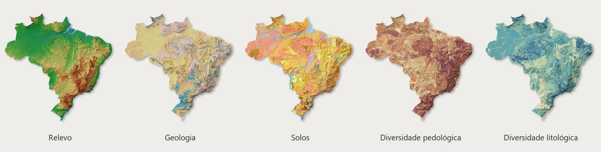

# Atlas do Brasil

**Relevo, geologia, solos e diversidade** — cinco leituras do território sobre o mesmo relevo sombreado.

[**Explorar o atlas**](https://moquedace.github.io/brazil_shaded_relief_maps/) · [**Baixar pranchas**](https://moquedace.github.io/brazil_shaded_relief_maps/#downloads) · [**Como citar**](https://moquedace.github.io/brazil_shaded_relief_maps/#fontes)

O relevo foi renderizado no Blender a partir do GEDTM30 v1.2, com base de 30 m, luz de noroeste e exagero vertical em duas escalas (128× nas formas amplas e 8× no detalhe). A série usa SIRGAS 2000 / Policônica (EPSG:5880). As bases temáticas são de 1:250.000; a resolução do raster não muda a escala de interpretação dos temas. A diversidade é uma contagem de componentes pedológicos ou litologias **por unidade de mapeamento**.

O atlas oferece comparação de dois temas, visualizador com imagens de até 120 m por pixel, PDFs A0 e versões de tela. Os seis PDFs originais para gráfica estão na [release v1.0](https://github.com/moquedace/brazil_shaded_relief_maps/releases/tag/v1.0). Os rasters de produção a 30 m e os dados de entrada não integram o repositório.

## Reprodução

O fluxo foi produzido em Windows. Use Python 3.13 com `numpy`, `scipy`, `rasterio`, `Pillow`, `reportlab`, `PyMuPDF` e as dependências do download (`geopandas`, `pandas`); R com `terra`, `sf`, `dplyr`, `readr`, `future` e `future.apply`; Blender 4.5 LTS com Cycles. A composição das pranchas usa Georgia e Segoe UI. Confira os caminhos de entrada nos scripts 01–03: os dados harmonizados de solos e litologia ficam nos projetos irmãos; o limite nacional e o DEM ficam na pasta de dados indicada nesses scripts.

| Etapa | Entrada e saída |
|---|---|
| `01_download_gedtm30_brazil.py` → `02_prepare_dem.R` | GEDTM30, grade nacional, DEM a 30 m e heightmaps. |
| `03_rasterize_thematic.R` | Bases harmonizadas e contorno → classes, máscaras e tabelas na grade do DEM. |
| `06_prepare_hybrid_terrain.py` → `07_render_hybrid.py` | Terreno híbrido → renders cinza por bloco. Rode o 07 pelo Blender com `--context-km 5000`. |
| `08_compose_hybrid.py --mode full --presentation balanced` | Renders e tabelas → mosaicos temáticos RGB com visões gerais. |
| `10_atlas_plates.py` → `11_atlas_multiformat.py` | Pranchas A0, telas e imagens do atlas; o 09 é uma biblioteca desta etapa. |
| `12_build_site.py` | Site estático com pranchas, comparação e pirâmide de zoom. |

Consulte as opções e exemplos no cabeçalho dos scripts. O fluxo final não exige os experimentos dos scripts 04 e 05. Se mudar uma paleta, rode o 08 com `--themes` para os temas alterados e `--overwrite`, depois atualize 10, 11 e 12. As imagens intermediárias e o zoom usam assinaturas dos arquivos de origem para detectar recompilação. Para editar só a página com os mapas atuais, use `12_build_site.py --skip-zoom` após os produtos já existirem.

O [histórico de produção](HISTORICO.md) preserva os testes, parâmetros e tempos de execução. As fontes e a bibliografia estão na seção [Fontes e citação](https://moquedace.github.io/brazil_shaded_relief_maps/#fontes).

## Autoria e licença

Cássio Moquedace · Departamento de Ciência do Solo, ESALQ/USP · 2026. Mapas, imagens e textos: [CC BY 4.0](https://creativecommons.org/licenses/by/4.0/deed.pt-br). Código: [MIT](LICENSE). Veja a [citação do atlas](CITATION.cff).
